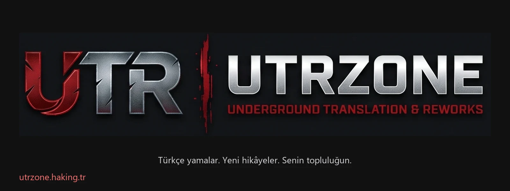

<p align="center"></p>

# UTRZONE

Türkçe oyun yamaları, modlar ve oyuncu topluluğu. **Sürüm 0.10.0** · React / Vite

[Siteyi keşfet](https://utrzone.haking.tr) · [VIP](https://utrzone.haking.tr/vip) · [Destek](https://buymeacoffee.com/haking)

Ren'Py ve Unity kataloğu; çoklu görsel galerisi, favoriler, oyun istekleri, UCoin erken erişim ve rol tabanlı yönetim. Karanlık tema varsayılandır; açık tema ve yetişkin kapak görünürlüğü kullanıcı tarafından seçilir. VIP ve erken erişim izinleri API üzerinde denetlenir.

## Yerel geliştirme

Node.js 22.12+ gerekir.

```powershell
npm ci
Copy-Item .env.example .env
npm run dev
```

.env içindeki VITE_API_URL yerel backend için http://localhost:3001/api olur. Gerçek anahtarları frontend'e koymayın; VITE_ değişkenleri tarayıcıya açıktır.

## Kontroller

```powershell
npm test
npm run build
npm run format:check
```

## Cloudflare yayını

Depo kökü frontend uygulamasıdır. Build komutu npm run build, çıktı dizini dist. Mevcut Workers Static Assets yayını korunur. Üretim VITE_API_URL değeri https://unlocktr-backend.onrender.com/api; VITE_ADMIN_ROUTE_SLUG varsayılanı founder-console. Özel alan adı utrzone.haking.tr.

HTML ve fingerprintli varlıkların önbellek politikaları ayrı uygulanır. Sunucuya doğrudan açılan sayfalar için build gerçek HTML girişlerini üretir. API ve üye izinleri ayrı [backend deposundadır](https://github.com/HaKING06/UnlockTR-Backend). Görseller https://utr.haking.tr üzerinden de sunulabilir.

[Katkı rehberi](CONTRIBUTING.md) · [Güvenlik](SECURITY.md) · [Topluluk ilkeleri](CODE_OF_CONDUCT.md) · [Lisans](LICENSE)
