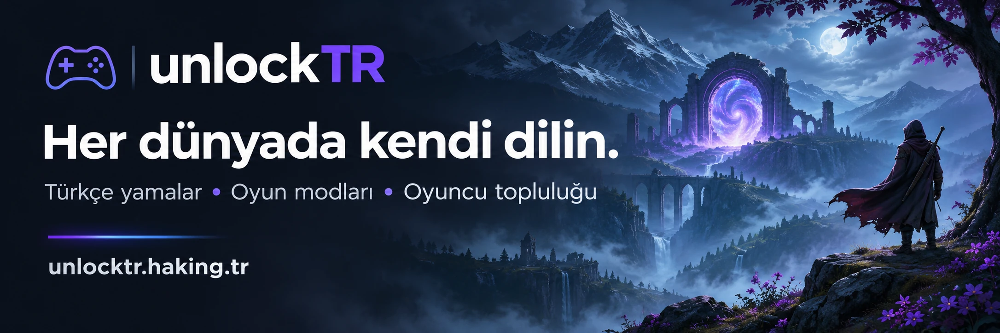
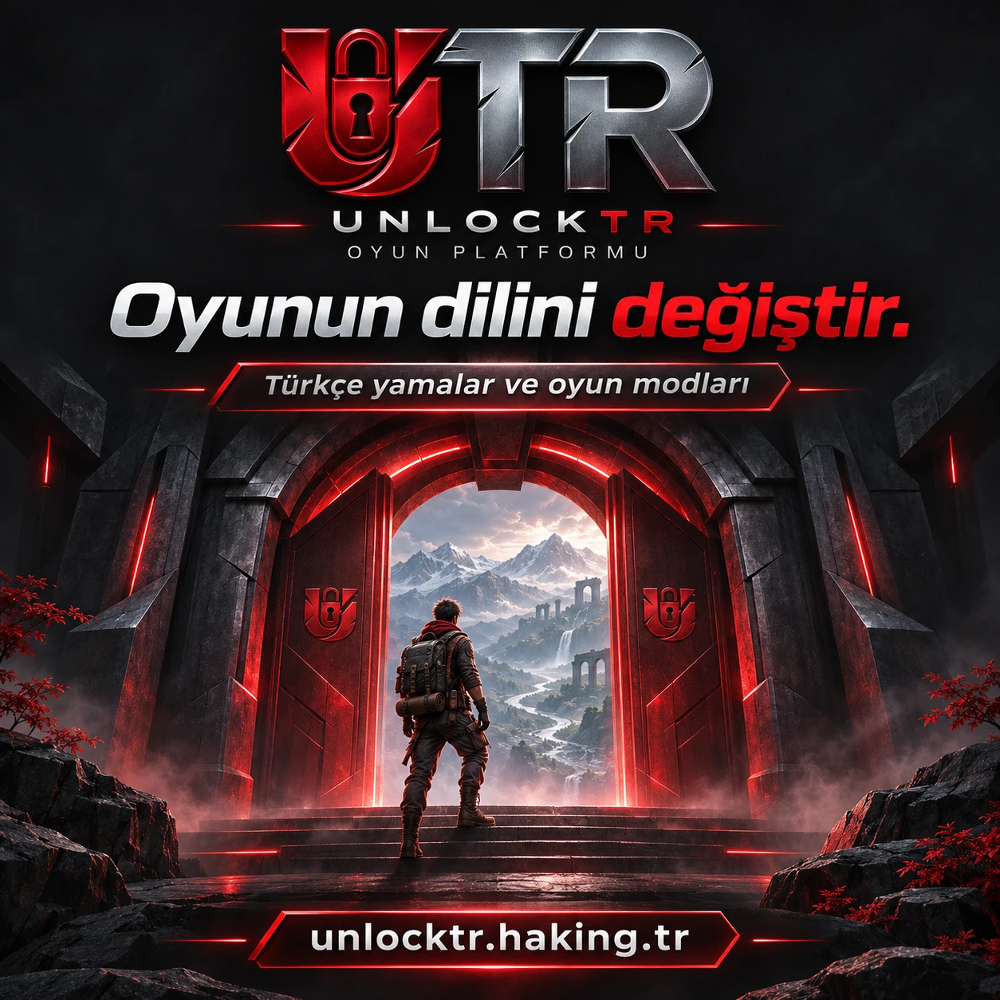

<p align="center">
  
</p>

<p align="center">
  
  
  
</p>

<p align="center">
  <a href="https://unlocktr.haking.tr"><strong>Siteyi keşfet</strong></a> ·
  <a href="https://unlocktr.haking.tr/vip">VIP</a> ·
  <a href="https://buymeacoffee.com/haking">Destek ol</a> ·
  <a href="docs/AI_HANDOFF.md">Küçük görevler için proje notu</a>
</p>

# UnlockTR · Frontend

**Türkçe yamalar, oyun modları ve oyuncu topluluğu.** UnlockTR; oyunları keşfetme, yama indirme, deneyim paylaşma ve yeni oyun isteme akışlarını aynı platformda toplar.

> **Mevcut sürüm: 0.6.0.** UTR marka kimliği, gelişmiş topluluk araçları ve kurumsal iletişim.

## İçindekiler

[Öne çıkanlar](#öne-çıkanlar) · [Hızlı başlangıç](#hızlı-başlangıç) · [Sayfalar](#sayfalar) · [Cloudflare](#cloudflare-dağıtımı) · [Dokümanlar](#dokümanlar) · [Katkı](#katkı-ve-güvenlik)

## Öne çıkanlar

| Oyuncular için | Ekip için |
|---|---|
| Ren'Py ve Unity oyunları, TR yama/mod etiketleri | Açıklamalı oyun yayın stüdyosu ve düzenleme |
| Ayrı URL'de oyun, kurulum ve uyumluluk bilgileri | Rol tabanlı kurucu / yardımcı kurucu / moderatör alanı |
| Reklamlı standart indirme; VIP alternatifleri | Yorum düzenleme, gizleme ve istek durumları |
| Kodla e-posta doğrulama ve kalıcı oturum | E-postayla üye arama, rol ve süreli VIP atama |
| NSFW tercihi, dark/light tema, altı kutulu kod | VIP/istek bildirim kuyruğu ve işlem geçmişi |

VIP üyelik **49 TL/ay** veya **399 TL/yıl** olarak sunulur. Satış [ItemSatış mağazasında](https://www.itemsatis.com/profil/haking06.html), etkinleştirme kurucu tarafından yapılır. Site ödeme bilgisi almaz ve otomatik abonelik başlatmaz. VIP önceliği bir teslim garantisi değildir.

## Teknoloji

**React 19 · Vite 7 · Lucide React · CSS değişkenleri · Cloudflare Static Assets**

Backend ayrı depodadır: [UnlockTR-Backend](https://github.com/HaKING06/UnlockTR-Backend). Frontend sır veya doğrudan veritabanı bağlantısı içermez.

## Hızlı başlangıç

Node.js **22.12+** kullan.

```powershell
npm ci
Copy-Item .env.example .env
npm run dev
```

.env içinde yerel API adresini tanımla:

```dotenv
VITE_API_URL=http://localhost:3001/api
VITE_ADMIN_ROUTE_SLUG=founder-console
```

API hazır değilse gerçek bağlantı hatası gösterilir; ürünün içine demo oyun/yorum eklenmez.

| Komut | Amaç |
|---|---|
| npm run dev | Yerel geliştirme |
| npm run build | dist üretim çıktısı |
| npm run preview | Build önizlemesi |
| npm run format:check | Biçim kontrolü |
| npm run format | Kaynak biçimlendirme |

## Sayfalar

| Yol | Amaç |
|---|---|
| / | Vitrin, katalog, arama ve filtreler |
| /game?id=UUID | Oyun, mod kapsamı, indirme ve yorumlar |
| /login · /register · /verify | Üyelik ve kodla doğrulama |
| /forgot-password · /account | Hesap kurtarma ve ayarlar |
| /requests | İstek gönderme ve yanıt geçmişi |
| /vip · /support | Üyelik ayrıcalıkları ve gönüllü destek |
| /manage | Yetkiye göre yönetim merkezi |
| /privacy | Çerez ve hesap depolaması açıklamaları |

Build her sabit yol için gerçek HTML girişi üretir. Workers'ta döngüye neden olan `/* /index.html 200` kuralını ekleme. Yeni sayfa eklenirse vite.config.js girişlerini de güncelle.

## Cloudflare dağıtımı

Bu depo frontend uygulamasının **kendisidir**; Root Directory boş kalır.

| Ayar | Değer |
|---|---|
| Build | npm run build |
| Assets / output | dist |
| VITE_API_URL | https://unlocktr-backend.onrender.com/api |
| VITE_ADMIN_ROUTE_SLUG | founder-console veya backend ile aynı alias |
| Custom domain | unlocktr.haking.tr |

VITE değişkenleri build zamanında okunur; değiştirince yeni build gerekir. Worker runtime secret alanı bunun yerine geçmez. DATABASE_URL, RESEND_API_KEY ve JWT_SECRET yalnız backend'dedir. API değişikliğinde önce Render backend, ardından Cloudflare frontend yayınlanır.

## Dokümanlar

| Belge | Ne zaman okunmalı? |
|---|---|
| [Kısa proje özeti](docs/AI_HANDOFF.md) | Sınırlı bir bakım işi için gerekli bağlam |
| [Mimari ve dosya haritası](docs/ARCHITECTURE.md) | Hangi dosyanın ne yaptığını bulmak için |
| [Görsel brief](docs/VISUAL_BRIEF.md) | Arayüz iyileştirmesi öncesinde |
| [Hazır AI görev metni](docs/NEXT_AI_PROMPT.md) | Projeyi yeniden anlatmadan görev vermek için |
| [Kontrol rehberi](docs/VALIDATION.md) | Değişiklik doğrulaması ve yayın sırası |
| [Kısa bakım notları](docs/MAINTENANCE_NOTES.md) | Son doküman güncellemesinin kapsamı |
| [0.5.0 yayın notları](RELEASE-0.5.0.md) | Son kod tesliminin ayrıntıları ve sınırları |
| [Tanıtım görselleri](docs/media/README.md) | README kapağı ve paylaşım afişleri |

## Doğrulama durumu

0.5.0 için backend 13 testi geçti. 390px/768px Playwright kontrolleri mock API ile yapıldı; canlı Resend teslimi ve üretim performansı ölçülmedi.

## Tanıtım ve destek

[PNG yatay kapak](docs/media/unlocktr-banner.png) · [PNG kare afiş](docs/media/unlocktr-poster.png) · [Buy Me a Coffee](https://buymeacoffee.com/haking)

<p align="center"></p>

Afişler projeye özel üretilmiş illüstrasyonlardır; canlı ekran görüntüsü veya bir oyunun resmi kapağı değildir. Gönüllü destek otomatik VIP vermez.

## Katkı ve güvenlik

[Katkı rehberi](CONTRIBUTING.md) · [Güvenlik politikası](SECURITY.md) · [Topluluk ilkeleri](CODE_OF_CONDUCT.md) · [Değişiklik geçmişi](CHANGELOG.md)

**Lisans:** [LICENSE](LICENSE) hakları saklı tutar. Açık kaynak lisansı henüz seçilmedi; depoyu görebilmek yeniden dağıtım izni anlamına gelmez.

## 0.5.0 güncellemesi

[UTR kimliği ve yayın adımları](RELEASE-0.5.0.md). Yeni SQL migration veya secret gerekmez. Destek: [unlocktr@haking.tr](mailto:unlocktr@haking.tr). Kurucu ve yardımcı kurucular yönetimden **Kurumsal e-posta** ekranına erişebilir.

### 0.5.1 · Orijinal marka ikonu

Favicon ve uygulama ikonları kullanıcı marka paftasındaki kare U ikonundan kırpılarak üretildi; yeniden çizilmedi. ICO, PNG, Apple touch icon ve uygulama manifesti eklendi. Manifest çevrimdışı çalışma garantisi içermez; service worker eklenmedi. Backend 0.5.0 olarak kaldı.

## 0.5.2 bakım sürümü

[Hatalar, katalog iyileştirmeleri ve yayın adımları](RELEASE-0.5.2.md). Hesap menüsü katmanı, tam katalog filtreleri, sayfalama, profil kaydı ve yayın stüdyosu düzeltildi. 15 backend testi ve 390px/768px mock UI kontrolleri geçti. Yeni SQL migration veya secret gerekmez.

## 0.6.0 · UCoin ve erken erişim

Günlük ödüller, VIP coin avantajları, kurucu manuel yüklemesi, doğrulamalı proje silme/iade ve yeni hesap silme modeli eklendi. **Yayın öncesi 0.6.0 SQL migration zorunludur.** [Kurulum, ekonomi ve doğrulama notları](RELEASE-0.6.0.md). Yeni secret gerekmez.
