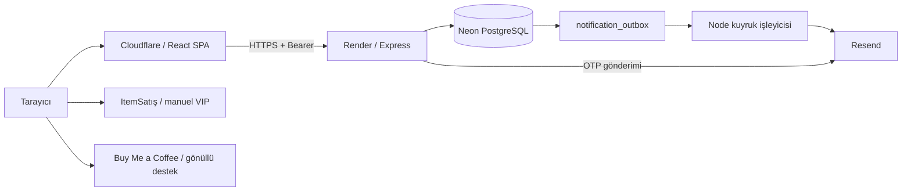

# Mimari · 0.4.0

## Frontend haritası

| Dosya | Sorumluluk |
|---|---|
| src/main.jsx | Vitrin, katalog, üst menü ve route seçimi |
| src/api.js | API istemcisi, ortam değişkenleri ve motorlar |
| src/state.jsx | Oturum, /me kontrolü, NSFW ve sekmeler arası durum |
| src/auth-pages.jsx | Giriş, kayıt, doğrulama, şifre sıfırlama |
| src/otp-input.jsx | Altı kutulu kod, yapıştırma, klavye/otomatik doldurma |
| src/member-pages.jsx | Hesap, VIP ve ayrı oyun sayfası |
| src/account-deletion.jsx | E-posta onaylı silme akışı |
| src/admin-page.jsx | Yetkili sekmeler, kullanıcı/VIP, moderasyon, bildirim kuyruğu |
| src/game-editor.jsx | Açıklamalı oyun yayın formu |
| src/game-data.js | Mod etiketleri |
| src/request-page.jsx | Üye istekleri ve yönetim yanıt şablonları |
| src/site-extras.jsx / consent.js | Destek, depolama politikası, çerez tercihleri |
| src/components.jsx / ui.jsx | Kapak ve ortak arayüz öğeleri |
| src/style.css | Tasarım sistemi, temalar, responsive ve hareket |
| vite.config.js | Sabit HTML sayfa girişleri ve başlık/robots üretimi |

Sabit yollar: /login, /register, /verify, /forgot-password, /account, /game, /vip, /manage, /requests, /support, /privacy ve eski admin slug alias'ı. Dosya adı `game.html`, kullanıcı adresi `/game?id=UUID` olur. Google sitelinks veya oyunların ayrı indekslenmesi garanti edilmez.

## Backend haritası

| Dosya | Sorumluluk |
|---|---|
| src/server.js / config.js / db.js | Başlatma, env doğrulama, pg havuzu |
| src/app.js | CORS, güvenlik başlıkları, rate limit, katalog/istek rotaları |
| src/auth-routes.js / otp.js | Üyelik ve amaca bağlı tek kullanımlık kodlar |
| src/access.js / security.js | JWT, DB oturumu, anlık rol/VIP kontrolü |
| src/account-routes.js | Profil, şifre, silme onayı |
| src/admin-routes.js | Oyun, yorum, istek, rol, VIP, audit ve kuyruk yönetimi |
| src/mail.js / notifications.js | Resend içerikleri, idempotency ve kuyruk işleyicisi |
| schema.sql / migrations | İlk şema ve kayıplı olmayan sürüm geçişleri |
| scripts/migrate.js | Şema + 0.3.0 + 0.4.0 geçişlerini sırayla uygulama |
| test/api.test.js | PGlite + Supertest davranış/yetki testleri |

## Temel veri modeli

users, games, comments, requests; email_verifications (eski link uyumluluğu), auth_challenges (verify/reset/delete), auth_sessions, audit_logs, notification_outbox ve schema_migrations.

- comments.is_deleted soft-delete; hesap silmede kullanıcı adı anonim kalır.
- requests.vip_priority sunucu tarafından belirlenir. Durum: pending/reviewing/preparing/completed/declined.
- games.mod_types text dizisidir; ad/ilişki modu istenen kurala göre 18+ etiketiyle işlenir.
- Bildirim, ilgili VIP/istek değişikliğiyle aynı SQL statement'ta kuyruğa girer. Sağlayıcı hatası iş değişikliğini geri almaz.

## Dağıtım ve işletim

Frontend ve backend ayrı depodur. API önce, frontend sonra yayınlanır. Üretim sırları yalnız Render'dadır. Workers static assets dağıtımı yapıldığından Pages varsayımlarını körlemesine uygulama. CORS tek FRONTEND_URL origin'ine bağlıdır.

Kuyruk aynı Node sürecinde 30 saniyelik taramayla çalışır. SKIP LOCKED, en fazla 5 deneme ve sabit idempotency anahtarı kullanır. Sent sağlayıcının kabulünü ifade eder; inbox teslim webhook'u yoktur. Uyuyan Render süreci bildirimleri geciktirebilir. Rate limit tek instance belleğindedir. Harici VIP URL paylaşımını önleyen DRM bulunmaz.
